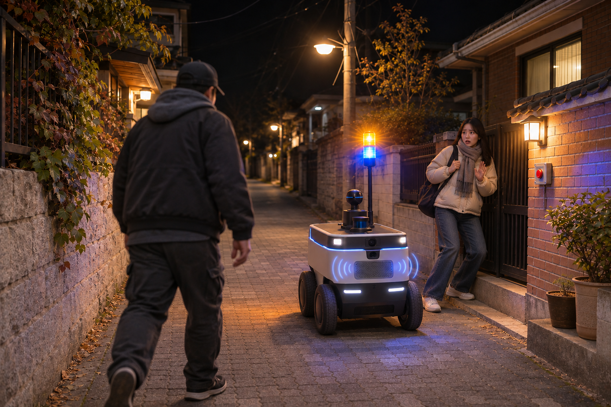
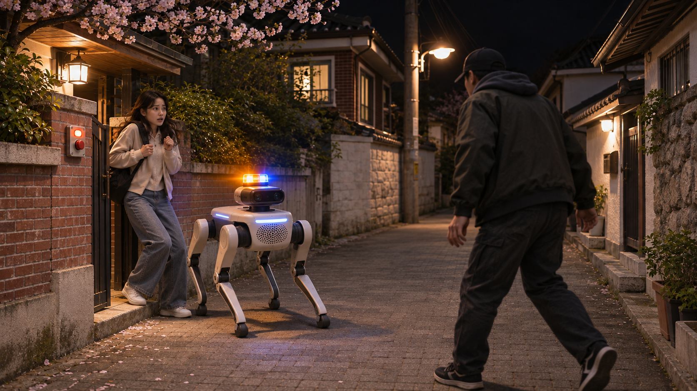

# 비상상황 대응 구상 이미지

이 두 이미지는 **늦은 밤 주택가 골목에서 위협적인 사람이 몇 걸음 앞까지 접근한 상황**을 표현한 AI 생성 구상 사진입니다. 실제 제품, 실험 결과 또는 112 연동 장면이 아닙니다. 이족보행형은 이번 비상 대응 이미지 비교에서 제외했습니다.

## 4바퀴형: 표시등과 큰 음성으로 도움 요청

## 4족형: 보행자 곁에서 경고하고 이탈 경로 확보

## 사진에서 표현하려는 동작 순서

1. 보행자가 스마트폰이나 **별도의 비상 버튼**으로 긴급 신호를 보냅니다.
2. 시스템은 **112용 신고 신호와 운영 상황실 경보를 동시에 만드는 것**을 목표로 합니다. 사진만으로 이 통신을 증명할 수는 없습니다.
3. 로봇은 표시등과 큰 음성·경고음으로 주변에 상황을 알리고 보행자 곁에 머뭅니다.
4. 보행자가 밝은 출입구 등으로 물러날 수 있게 통로를 남깁니다. 로봇이 사람을 밀거나 범죄자를 물리적으로 제압하지 않습니다.

현재 [D03 요구사항](../../../docs/requirements.md)은 모의 비상 입력에서 **두 알림 기록을 같은 시뮬레이션 단계에 남기는 기준**까지 정했습니다. 실제 112 연결, 사이렌·음성 출력, 위협 감지와 보행자 보호 효과는 구현·검증 전입니다.
