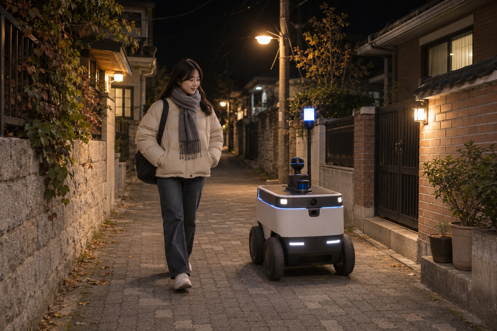
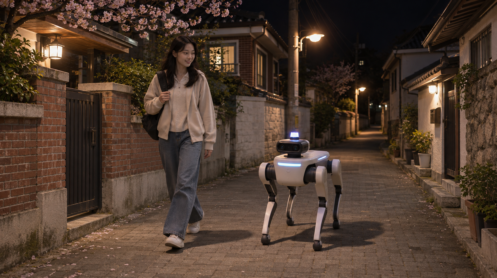
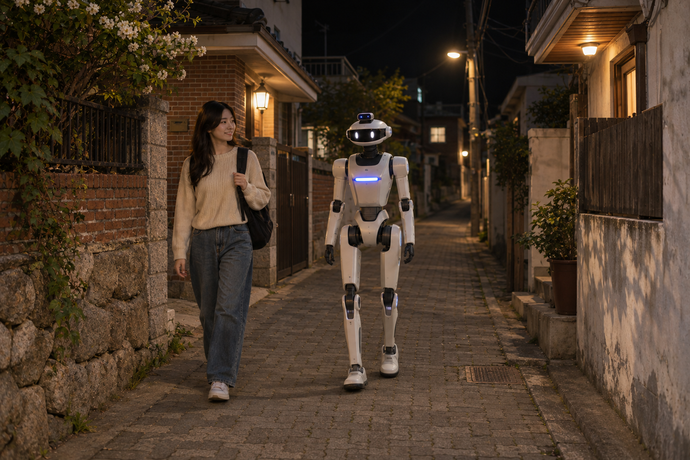

# 야간 동행 로봇의 이동 형태 후보

**현재 결정 상태: 미정.** 아래 이미지는 늦은 밤 인적이 드문 주택가 보행로에서 성인 대학생과 동행하는 모습을 표현한 AI 생성 구상 이미지입니다. 실제 제품 사진이나 확정된 설계·치수·성능 자료가 아닙니다. 기존 MuJoCo XML의 4바퀴형은 장면 배치를 위한 임시 모델입니다.

## A. 4바퀴형

평평하고 연속된 보행로를 주행하는 안입니다. 첫 프로젝트에서 주행과 호출·동행 흐름을 구현하기에 우선 검토할 만합니다. 실제 경로에 계단·높은 턱·끊긴 보행로가 있는지 먼저 확인해야 합니다.

## B. 4족보행형

발을 디뎌 이동하는 안입니다. 턱이나 불규칙한 지면이 많은 경로를 고려할 때 후보가 됩니다. 보행 제어, 넘어짐, 보행자와의 간격을 별도로 검증해야 합니다.

## C. 이족보행형

사람과 비슷한 높이의 두 발 로봇 안입니다. 눈에 잘 띄는 동행 형태를 생각할 수 있지만, 균형과 넘어짐에 대한 설계·검증이 필요합니다. 이 프로젝트의 핵심 기능에 두 발이 꼭 필요한지 검토해야 합니다.

## 결정 전에 확인할 네 가지

1. 후보 순찰 구간에 계단, 높은 턱, 급경사, 끊긴 보행로가 있습니까?
2. 500 m와 2 km 구간에서 필요한 순찰·호출 응답 시간을 어떤 형태로 달성할 수 있습니까?
3. 야간 보행자와 마주칠 때 남는 통행 폭과 넘어짐 위험은 어떻습니까?
4. 팀이 MuJoCo에서 해당 형태의 이동을 실제로 구현하고 검증할 수 있습니까?

**잠정 의견:** 순찰 구간이 평평한 보행로라면 4바퀴형을 우선 후보로 검토합니다. 최종 선택은 현장 경로와 팀의 구현 범위를 확인한 뒤 기록합니다.

가까운 위협 상황에서 바퀴형·4족형이 경고등과 음성으로 도움을 요청하는 모습은 [비상 대응 구상 이미지](../assets/concepts/emergency/README.md)에 따로 정리했습니다. 사진은 기능의 제안이며 구현 결과가 아닙니다.
